<!-- Las tarjetas son SVG generados por scripts/render_cards.py y actualizados a diario
     por .github/workflows/update-profile-cards.yml. Mantén las tarjetas de una misma fila en una
     sola línea y sin espacios entre ellas. -->

 
 
 
 
 

<a href="https://lukasgarrido-portfolio.vercel.app/">portafolio</a> &nbsp;/&nbsp; <a href="https://linkedin.com/in/lukas-garrido-400130397/">linkedin</a> &nbsp;/&nbsp; <a href="https://github.com/LukasGarrido?tab=repositories">repositorios</a>

